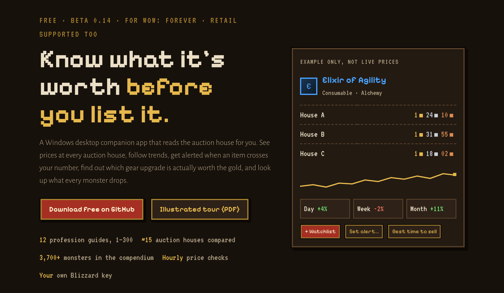

# Awesome House

[](https://kadestclair-dotcom.github.io/awesome-house/)

A free Windows companion app that reads the World of Warcraft auction house for you. Built for **WoW: Forever**, with retail supported too.

**[⬇ Download the latest release](https://github.com/kadestclair-dotcom/awesome-house/releases)** · **[Website](https://kadestclair-dotcom.github.io/awesome-house/)** · **[Illustrated tour (PDF)](docs/about-awesome-house.pdf)**

> **Beta 0.16.** Features are still being added and you may run into bugs. Please [report them](../../issues).

---

## What it does

| Tab | What you get |
| --- | --- |
| **Search** | Browse auction-house categories, filter by quality, level and price, and see the price at every auction house side by side. |
| **Watchlist** | Day, Week and Month trends, a price history chart, a sell helper that shows your payout after the 5% cut, the best time to sell, and price alerts. |
| **Character** | Look up a character, scan every gear slot, and see which items for sale are an upgrade your class can actually use (Upgrade %). **Upgrades from dungeons** scores dungeon and raid drops the same way and names the monster that drops each. |
| **Monster Compendium** | Every monster in each region, what it drops (priced on the AH), and the quests that need it or its drops. Names link to Wowhead or Warcraft Wiki. Track the monsters you're farming, with a kill counter and notes. Shows where each monster spawns, with **Copy waypoint** for the TomTom addon. |
| **Dungeons** *(new)* | Every WoW: Forever dungeon and raid in the monster data: where the entrance is, a route there for each faction, the monsters inside, what they drop (priced on the AH), and the quests that send you in. |
| **Progress** *(new)* | Load a WoW: Forever character to see quests done per zone, the current quest log, milestones, reputations, PvP, dungeon and raid progress and professions, plus a "what to do next" list built from the quests open to that character. **Tonight's route** orders your open quests into stops with waypoints. **My characters** lists every character you've loaded side by side. **Guild crafters** shows who in your guild can make a recipe. |
| **Professions** | Every Blizzard recipe priced at current auction prices, material prices, and gold per hour for gathering sessions. |
| **Guides** | Leveling guides 1–300 for all 12 professions, priced live, with the cheapest option marked. |
| **Tools** | Flip finder, custom crafting recipes, fishing spot planner, CSV export. |

## Get started (about 5 minutes)

1. Download `AwesomeHouse-….zip` from the [Releases page](../../releases) and unzip it into a folder of its own, e.g. `Desktop\Awesome House`.
2. Run `AwesomeHouse.exe`. The app isn't code-signed yet, so Windows may say *"Windows protected your PC"*. Click **More info**, then **Run anyway**.
3. Create a free Blizzard API client at [develop.battle.net](https://develop.battle.net/access/clients) and paste its Client ID and Secret into the setup window. The `README.txt` in the zip walks through every field.

## Is it safe to download?

You shouldn't have to take anyone's word for it, so here is how you can check:

- **The source code is right here.** You can read all of it.
- **GitHub builds every release itself**, on its own Windows machine, straight from this code (see [`.github/workflows/release.yml`](.github/workflows/release.yml)). Nobody uploads an exe by hand.
- **Each release has a signed build record.** With the [GitHub CLI](https://cli.github.com/) installed, run
  `gh attestation verify AwesomeHouse-<version>.zip --repo kadestclair-dotcom/awesome-house`
  to confirm the file came from this repository's code.
- **Each release lists SHA-256 checksums** in `SHA256SUMS.txt`. In PowerShell, `Get-FileHash .\AwesomeHouse-*.zip` should print the same code.
- **You can skip the exe entirely.** The app is plain Python using only the standard library. Install [Python 3.12+](https://www.python.org/downloads/), download this repository (**Code › Download ZIP**), unzip it into a folder of its own and double-click `wow_price_gui.pyw`.
- **Your data stays on your PC.** You use your own Blizzard key. The app never asks for your Battle.net password. It only talks to Blizzard's API, and to GitHub to download the free [QuestieDB](https://github.com/Questie/QuestieDB) monster data (it asks first).

More in [SECURITY.md](SECURITY.md).

## Things to know

- Blizzard's WoW: Forever API isn't officially documented, so parts of the app could break if Blizzard changes it.
- Blizzard is missing data for many Classic-era items, so some items have no name, stats or upgrade score.
- Prices update about once an hour. Price history only records while the app is open.
- The 5% auction house cut and the upgrade scores are estimates.
- The Monster Compendium's data is community-made and still filling in for Forever's new areas. Drop chances are only known for quest items.
- The Dungeons tab's travel routes are written from Classic-era geography and haven't been checked in Forever yet. Routes for Forever's new dungeons aren't recorded. **Edit routes** in the tab opens `dungeon_travel.json` so you can correct them.
- The Progress tab reads what Blizzard last saved for a character, which updates when the character logs out. Its quest suggestions depend on QuestieDB's quest list, so a quest can be missing or listed too early.
- Some antivirus programs wrongly flag apps packed with PyInstaller. Please don't turn your antivirus off for it: check the checksum above, or run it from source instead.
- Your Blizzard Client Secret is saved in `wow_price_config.json` next to the app. Don't share your app folder once it's set up.

## Support the project

Awesome House is free, and **every feature is free for everyone**. That isn't only a choice: Blizzard's [Developer API Terms](https://www.blizzard.com/en-us/legal/a2989b50-5f16-43b1-abec-2ae17cc09dd6/blizzard-developer-api-terms-of-use) don't allow apps like this to charge for downloads or sell premium features.

If it saves you gold and you'd like to say thanks, you can donate at **[paypal.me/keedoyesyes](https://paypal.me/keedoyesyes)**. Donations never unlock anything in the app. See [docs/support.md](docs/support.md) for what supporters get.

## Report a bug or suggest something

Open an [issue](../../issues), or use **Support › Report a bug** in the app. Screenshots help. Never post your Client Secret.

## Build it yourself

Requires Windows and Python 3.12 (only the standard library is used).

```bat
build_exe.bat
```

This installs PyInstaller, builds `dist\AwesomeHouse.exe`, and zips the share package. To make an official release, see [docs/publishing.md](docs/publishing.md).

## License and credits

Privacy policy: [PRIVACY.md](PRIVACY.md). In short: everything stays on your PC, and data from Blizzard is deleted after 30 days.

**Source-available, all rights reserved.** © 2026 Kade. The code is public so you can see exactly what the app does. You may use the app for free for personal, non-commercial use. Please don't redistribute, sell, rebrand or publish modified copies. Full terms are in [LICENSE](LICENSE).

- Monster Compendium, Dungeons and Progress data: [QuestieDB](https://github.com/Questie/QuestieDB), the Questie addon's community database by the Questie team and contributors, used with their permission. It is downloaded separately on your computer, isn't part of this repository, and stays under [QuestieDB's license](https://github.com/Questie/QuestieDB/blob/master/LICENSE.md).
- Pixel fonts [Pixelify Sans](https://fonts.google.com/specimen/Pixelify+Sans) and [VT323](https://fonts.google.com/specimen/VT323) under the SIL Open Font License 1.1. The capital C and G and the lowercase c of Pixelify Sans were modified to be easier to read at small sizes.

Auction, item and character data comes from Blizzard Entertainment's API. Awesome House is a fan-made tool, not affiliated with or endorsed by Blizzard Entertainment. World of Warcraft and Blizzard Entertainment are trademarks or registered trademarks of Blizzard Entertainment, Inc., in the U.S. and/or other countries.
